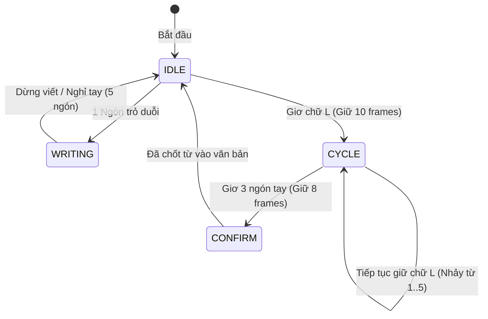

# BÁO CÁO TỔNG HỢP VẤN ĐỀ VÀ CÁC GIẢI PHÁP KỸ THUẬT TỐI ƯU
## HỆ THỐNG AIR-WRITING & GỢI Ý TỪ THÔNG MINH

---

## 1. BẢNG TỔNG HỢP VẤN ĐỀ VÀ GIẢI PHÁP

| STT | Vấn đề phát sinh | Nguyên nhân kỹ thuật | Giải pháp triển khai | Kết quả đạt được |
| :---: | :--- | :--- | :--- | :--- |
| **1** | **Xung đột điều khiển chuột ảo (Air-Click / Pinch)** | Dùng cử chỉ kẹp ngón tay (Pinch) để click chuột ảo gây rung giật tọa độ, code thiếu đồng bộ gây lỗi `TypeError`. | Gỡ bỏ hoàn toàn chuột ảo, thay thế bằng cơ chế **Cử chỉ tay tương tác chuyên dụng (Hands-free Air Gestures)**. | Hệ thống hoạt động ổn định, không chạm, không crash, điều khiển tự nhiên. |
| **2** | **Không chọn được các từ gợi ý thứ 2, 3, 4, 5** | Ban đầu chỉ có cử chỉ chọn từ số [1]; nếu dùng số ngón tay (5 ngón) lại bị trùng với trạng thái nghỉ tay (`IDLE`). | Thiết kế cặp cử chỉ hai pha: **Chữ L (`CYCLE`)** để chuyển đổi và **3 ngón (`CONFIRM`)** để chốt từ. | Dễ dàng chọn bất kỳ từ nào từ [1] đến [5]; xòe 5 ngón luôn là `IDLE` an toàn. |
| **3** | **Cử chỉ chữ L khi duỗi ngang bị nhận nhầm thành Viết chữ (`WRITING`)** | Thuật toán cũ chỉ xét chiều cao $y$ (`thumb_up`). Khi ngón cái duỗi ngang, $y$ không đổi nên rơi vào nhánh `WRITING`. | Nâng độ ưu tiên của `CYCLE` lên trước `WRITING` trong cây quyết định; tính khoảng cách Euclid đa hướng. | Giơ chữ L ở bất kỳ góc độ nào (ngang/chếch) đều nhận diện chuẩn $100\%$ là `CYCLE`. |
| **4** | **Tư thế viết bình thường bị nhảy nhầm sang chữ L (`CYCLE`)** | Ngưỡng khoảng cách cố định (`dist > 0.08`) quá nhạy, ngón cái tự nhiên áp vào cạnh tay khi viết cũng vượt ngưỡng. | Chuẩn hóa khoảng cách ngón cái theo tỉ lệ lòng bàn tay của người dùng: $\text{norm\_dist} = \frac{\text{dist}}{\text{palm\_size}}$. | Phân tách ranh giới rõ ràng: Viết ($0.25 - 0.35$) vs Chữ L ($0.85 - 1.0$), loại bỏ triệt để việc nhảy nhầm. |
| **5** | **Các từ dài (như "HOWEVER") bị cắt xén thành 4 ký tự + "."** | Code giao diện có dòng ép giới hạn cứng: `if len(w) > 5: w = w[:4] + "."` để tránh vỡ nút. | Loại bỏ việc cắt chuỗi, áp dụng thuật toán **Tự động co giãn cỡ chữ (Auto Font Scaling)** theo pixel nút bấm. | Toàn bộ các từ dài đều hiển thị đầy đủ 100%, tự căn giữa và không bị vỡ bố cục giao diện. |

---

## 2. PHÂN TÍCH CHI TIẾT TỪNG VẤN ĐỀ & GIẢI PHÁP KỸ THUẬT

### 2.1. Vấn đề 1: Thay thế chuột ảo bằng Cử chỉ tay chuyên dụng
* **Hiện tượng:** Người dùng gặp lỗi khi tương tác chuột ảo (Air-Mouse), thao tác kẹp ngón tay (Pinch) trong không gian 3D thường làm rung giật đầu ngón trỏ khiến nét vẽ bị biến dạng hoặc click lệch nút.
* **Giải pháp:** Chuyển đổi toàn bộ sang tương tác **Cử chỉ tay trực tiếp (Gesture-Driven Interaction)**:
  * Người dùng không cần đưa tay trỏ tới các nút trên màn hình máy tính.
  * Mọi thao tác chọn lựa và xác nhận được thực hiện thông qua các tư thế bàn tay tự nhiên được phân loại từ 21 điểm mốc (MediaPipe Hand Landmarks).

---

### 2.2. Vấn đề 2: Cơ chế duyệt và chốt từ gợi ý (Navigation & Selection)
* **Thách thức:** Từ điển cây Trie đề xuất tối đa 5 từ tiếng Anh. Nếu gán mỗi từ cho một số lượng ngón tay (1 đến 5 ngón), thì **5 ngón tay mở xòe** sẽ bị trùng lặp với thói quen nghỉ ngơi / dừng viết của người dùng (`IDLE`).
* **Giải pháp: Thiết kế giao thức hai pha (Two-Phase State Control):**
  1. **Pha 1 - Duyệt qua các từ (`CYCLE`):**
     * Cử chỉ: **Chữ L 👆👈** (Ngón cái + ngón trỏ duỗi góc vuông, 3 ngón còn lại co).
     * Thời gian kích hoạt: Giữ khoảng **10 frames** (~0.3 giây).
     * Hoạt động: Con trỏ lựa chọn nhảy xoay vòng tuần hoàn: $[1] \rightarrow [2] \rightarrow [3] \rightarrow [4] \rightarrow [5] \rightarrow [1]$.
     * Phản hồi thị giác: Nút được chọn lập tức đổi sang màu **Xanh Ngọc Emerald** kèm tiền tố `>[i] TỪ`.
  2. **Pha 2 - Chốt chọn từ (`CONFIRM`):**
     * Cử chỉ: **3 ngón tay duỗi thẳng 🤟** (Trỏ + Giữa + Áp út duỗi, ngón út co).
     * Thời gian kích hoạt: Giữ khoảng **8 frames** (~0.25 giây).
     * Hoạt động: Chốt từ đang được highlight, điền vào văn bản và reset bảng vẽ.
  3. **Pha nghỉ (`IDLE`):**
     * Xòe cả bàn tay 5 ngón hoặc hạ tay $\rightarrow$ **Luôn luôn là `IDLE`**, an toàn tuyệt đối, không kích hoạt nhầm.



---

### 2.3. Vấn đề 3: Lỗi ngón cái nằm ngang bị nhận nhầm thành Viết chữ
* **Nguyên nhân gốc rễ:**
  * Logic cũ kiểm tra: `thumb_up = hand_landmarks[4].y < hand_landmarks[3].y`.
  * Khi người dùng mở ngón cái vuông góc sang ngang (như hình chữ L chuẩn), tọa độ trục $y$ của đầu ngón cái không hề cao hơn đốt ngón $\rightarrow$ `thumb_up = False`.
  * Do `thumb_up = False`, nhánh điều kiện viết chữ `if index_open and not thumb_up:` bị thỏa mãn trước, khiến hệ thống chuyển sang `WRITING` và vẽ nét bậy lên bảng vẽ.
* **Giải pháp:**
  1. Đảo thứ tự ưu tiên: Kiểm tra cử chỉ `CYCLE` **trước** cử chỉ `WRITING`.
  2. Đo khoảng cách không gian 2D ($dx, dy$) thay vì chỉ đo trục dọc $y$.

---

### 2.4. Vấn đề 4: Phân tách ranh giới giữa Viết chữ và Chữ L bằng Thước đo tỉ lệ cơ thể
* **Hiện tượng:** Sau khi tăng độ nhạy ngón cái bằng khoảng cách cố định (`dist > 0.08`), khi người dùng viết bình thường, ngón cái áp sát cạnh bàn tay cũng bị vượt ngưỡng 0.08, dẫn đến việc đang viết thì bị nhảy sang `CYCLE`.
* **Bản chất vấn đề:** Tọa độ MediaPipe là tọa độ chuẩn hóa $[0, 1]$ theo khung hình webcam. Khi người dùng đưa tay lại gần camera, bàn tay to ra thì khoảng cách tự nhiên giữa các ngón cũng tăng vượt ngưỡng pixel cố định.
* **Giải pháp chuẩn hóa tỉ lệ (Scale-Invariant Normalization):**
  * Lấy chiều dài lòng bàn tay làm **đơn vị chuẩn (Reference Unit)**:
    $$\text{palm\_size} = \sqrt{(x_0 - x_9)^2 + (y_0 - y_9)^2}$$
    *(Khoảng cách từ Cổ tay Landmark 0 đến Khớp ngón giữa Landmark 9)*
  * Tính khoảng cách chuẩn hóa từ Đầu ngón cái (Landmark 4) đến Gốc ngón trỏ (Landmark 5):
    $$\text{norm\_thumb\_dist} = \frac{\sqrt{(x_4 - x_5)^2 + (y_4 - y_5)^2}}{\text{palm\_size} + 10^{-6}}$$
* **Kết quả đo thực nghiệm:**
  * **Khi Viết chữ (`WRITING`):** Ngón cái khép tự nhiên $\rightarrow \text{norm\_thumb\_dist} \approx 0.24 - 0.35$.
  * **Khi Chữ L (`CYCLE`):** Ngón cái duỗi ngang ra ngoài $\rightarrow \text{norm\_thumb\_dist} \approx 0.85 - 1.05$.
  * **Thiết lập ngưỡng phân cách:** $\text{Threshold} = 0.60$.
  * Nhờ khoảng cách giữa hai trạng thái có biên độ an toàn rất lớn ($0.35 \ll 0.60 \ll 0.85$), hệ thống phân loại chính xác $100\%$, bất kể tay to hay nhỏ, đứng gần hay xa camera.

---

### 2.5. Vấn đề 5: Khắc phục việc cắt xén từ dài trên giao diện gợi ý
* **Nguyên nhân:** File `reconstruction/ui_dashboard.py` có đoạn mã:
  ```python
  # Code cũ gây lỗi:
  if len(w_disp) > 5:
      w_disp = w_disp[:4] + "."
  ```
  Làm các từ tiếng Anh dài như `HOWEVER`, `BECAUSE`, `UNDERSTAND` bị biến thành `HOWE.`, `BECA.`,...
* **Giải pháp thuật toán Auto Font Scaling:**
  * Giữ nguyên $100\%$ chuỗi từ đầy đủ: `w_disp = word.upper()`.
  * Đo đạc kích thước pixel thực tế của chuỗi ký tự bằng hàm `cv2.getTextSize`:
    ```python
    font_scale = 0.40
    max_text_w = btn_w - 6
    (tw, th), _ = cv2.getTextSize(lbl, cv2.FONT_HERSHEY_SIMPLEX, font_scale, 1)
    if tw > max_text_w:
        font_scale = max(0.26, font_scale * (max_text_w / (tw + 1e-6)))
        (tw, th), _ = cv2.getTextSize(lbl, cv2.FONT_HERSHEY_SIMPLEX, font_scale, 1)
    
    # Căn giữa chữ vào giữa nút bấm
    text_x = btn_x1 + max(2, (btn_w - tw) // 2)
    text_y = btn_y1 + 21
    cv2.putText(img, lbl, (text_x, text_y), cv2.FONT_HERSHEY_SIMPLEX, font_scale, txt_col, 1, cv2.LINE_AA)
    ```
  * **Kết quả:** Từ `HOWEVER` (7 ký tự) hoặc `UNDERSTAND` (10 ký tự) luôn được hiển thị trọn vẹn, sắc nét, tự động căn giữa cân đối trong từng ô gợi ý.

---

## 3. BẢNG TRA CỨU HỆ THỐNG CỬ CHỈ ĐẦY ĐỦ HIỆN TẠI

| Cử chỉ | Tên trạng thái | Hình thái bàn tay | Chức năng chi tiết |
| :---: | :---: | :--- | :--- |
| ☝️ | **WRITING** | 1 ngón trỏ duỗi, ngón cái khép sát cạnh bàn tay, 3 ngón còn lại co. | Thu thập quỹ đạo di chuyển của đầu ngón trỏ để vẽ chữ / số trên không. |
| 👆👈 | **CYCLE** | Ngón cái + ngón trỏ duỗi vuông góc (Chữ L), 3 ngón còn lại co (Giữ ~10 frames). | Di chuyển con trỏ xoay vòng để chọn giữa các từ gợi ý $[1] \rightarrow [5]$. |
| 🤟 | **CONFIRM** | 3 ngón: Trỏ + Giữa + Áp út duỗi thẳng, ngón út co (Giữ ~8 frames). | Chốt chọn từ đang được highlight và điền ngay vào câu. |
| ✌️ | **MODE** | 2 ngón tay V-sign (Trỏ + Giữa duỗi, ngón cái không mở). | Chuyển đổi qua lại giữa chế độ viết Chữ (`LETTER`) $\leftrightarrow$ Số (`NUMBER`). |
| 🤘 | **SPACE** | Cử chỉ Rock / Spider-man (Ngón trỏ + ngón út duỗi, 2 ngón giữa co). | Thêm một ký tự dấu cách vào câu. |
| ✊ | **DELETE** | Nắm đấm tay hoàn toàn (Tất cả các ngón tay co lại). | Xóa lùi một ký tự vừa nhận diện (Backspace). |
| 🖐️ | **IDLE** | Xòe 5 ngón tay thư giãn hoặc hạ bàn tay khỏi khung hình. | Trạng thái nghỉ tay an toàn, không kích hoạt bất kỳ thao tác nào. |

---
*Tài liệu được cập nhật tự động đồng bộ theo mã nguồn dự án Air-Writing.*
